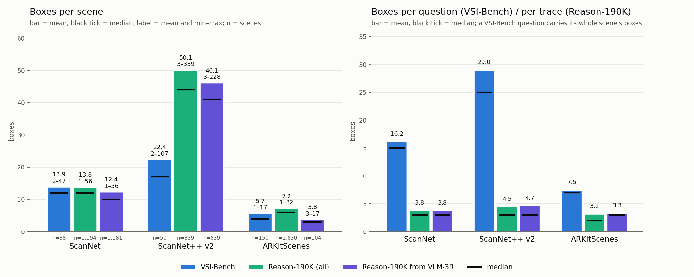
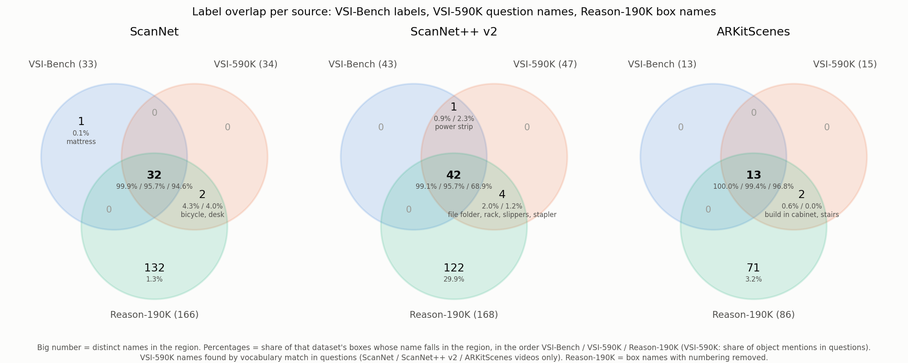
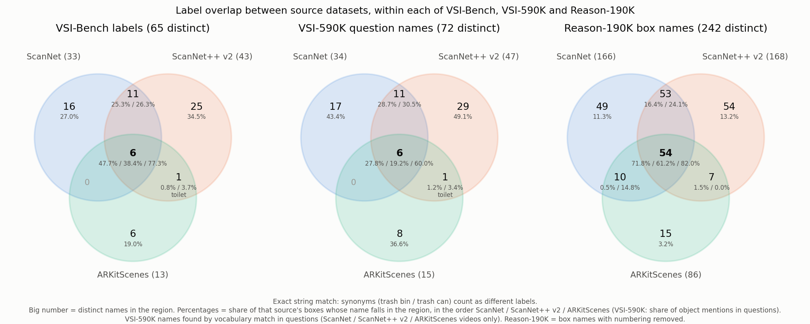

# VSI-Bench, VSI-590K and Reason-190K: questions, boxes, labels, frames

Statistics measured on 2026-10-29/30 from:

| Dataset | File |
|---|---|
| VSI-590K | `/lustre/fsn1/projects/rech/bef/uxt97ti/downloads/VSI-590K/vsi_590k.jsonl` |
| Reason-190K | `data/simplesr_train_traces.jsonl.gz` (145,647 traces; `source` = `vsi590k` or `vlm3r`) |
| VSI-Bench | `/lustre/fsn1/projects/rech/bef/uxt97ti/data/VSI-Bench/meta_info/*_meta_info_val.json` (boxes), `data/scenelang_vsibench_gt_firstcam/rows_all5130.jsonl` (questions) |

Only ScanNet, ScanNet++ v2 and ARKitScenes are compared unless stated otherwise (the three datasets VSI-Bench
and Reason-190K share).

## 1. Questions and videos

| Source | VSI-590K questions | VSI-590K videos | Reason-190K questions | Reason-190K videos | VSI-Bench questions | VSI-Bench videos |
|---|---:|---:|---:|---:|---:|---:|
| ScanNet | 92,145 | 1,201 | 50,430 | 1,194 | 2,071 | 88 |
| ScanNet++ v2 | 138,701 | 856 | 66,183 | 839 | 1,458 | 50 |
| ARKitScenes | 57,816 | 2,899 | 29,034 | 2,830 | 1,601 | 150 |
| Total | 288,662 | 4,956 | 145,647 | 4,863 | 5,130 | 288 |

VSI-590K has 590,667 questions in total; the other 302,005 come from images (216,519), ADT, S3DIS and ProcTHOR.
Reason-190K: 91,881 questions from VSI-590K and 53,766 from VLM-3R.

## 2. Boxes and reference frames

| | Boxes | Box format | Labels | Frame |
|---|---|---|---|---|
| VSI-590K | none (QA only) | – | object names only inside the question text | – |
| Reason-190K | in the `<scene>` block of every trace | `[x, y, z, w, d, h]`: centre + full size, axis-aligned, no yaw (all 584,807 boxes) | open vocabulary, repeated names numbered (`chair 1`, `chair 2`) | origin = camera of the first sampled video frame, z up, x/y along the room |
| VSI-Bench | `object_bbox[label]` per scene | 9-DoF oriented `{centroid, axesLengths, normalizedAxes, min, max}` | closed set per dataset, not numbered | per dataset (below); not frame 0 |

VSI-Bench frames:

| Dataset | `meta_info` frame | Frame-0 camera xy offset from the `meta_info` origin, median (range) |
|---|---|---|
| ScanNet | raw scan mesh minus its mean point; not room-aligned | 1.07 m (0.06–4.43) |
| ScanNet++ v2 | ScanNet++ mesh frame, z up, floor at z ≈ 0 | 2.44 m (0.00–13.6) |
| ARKitScenes | ARKit mesh frame (= VGGT-Det's); horizontal axes follow the phone's start heading | 0.07 m (0.04–0.23) |

Only 3.3% (ScanNet), 5% (ScanNet++) and 13.8% (ARKitScenes) of VSI-Bench boxes lie within 1° of the x/y axes.
The frame-0 version of the VSI-Bench ground truth is in `data/scenelang_vsibench_gt_firstcam/`
(`vsibench_*_scenelang.jsonl`, `frames.json`); two ScanNet++ scenes (`e7af285f7d`, `d755b3d9d8`) keep the world origin.

### ARKitScenes box sizes in Reason-190K

Trace boxes matched to the original ARKitScenes `obbAligned` annotations (2,149 boxes, 275 of 300 sampled scenes,
92% same label). Median error of the trace (w, d) against each hypothesis:

| Object yaw vs trace axes | Boxes | Original size, yaw dropped | AABB enclosing the rotated box | AABB of mesh points | Trace footprint ÷ original |
|---|---:|---:|---:|---:|---:|
| 0–2° | 300 | 1.8 cm | 1.6 cm | 1.9 cm | 1.05 |
| 2–10° | 872 | 1.8 cm | 5.0 cm | 3.8 cm | 1.04 |
| 10–25° | 487 | 3.0 cm | 14.8 cm | 12.1 cm | 1.06 |
| 25–45° | 490 | 9.5 cm | 19.7 cm | 18.3 cm | 1.11 |

"Yaw dropped" fits best (44% within 2 cm, 67% within 5 cm; enclosing boxes and an AABB in the raw ARKit axes are
ruled out), but it is not exact: trace footprints are 4–11% larger and the gap grows with yaw. For rotated
furniture the trace box under-covers the real footprint.

## 3. Question types

Shares of each column's total; the last row gives the totals.

| Question type (VSI-590K / Reason-190K name) | VSI-590K, all sources | VSI-590K, ScanNet + ScanNet++ + ARKit | Reason-190K total | Reason-190K from VSI-590K | Reason-190K from VLM-3R | VSI-Bench | VSI-Bench name |
|---|---|---|---|---|---|---|---|
| relative_direction_object | 30.0% | 34.8% | 20.9% | 19.5% | 23.4% | 18.9% | object_rel_direction_easy / medium / hard: 4.2% / 7.4% / 7.3% |
| relative_distance_object | 20.2% | 18.7% | 19.3% | 18.2% | 21.2% | 13.8% | object_rel_distance |
| absolute_distance_object | 10.0% | 10.1% | 20.2% | 17.7% | 24.5% | 16.3% | object_abs_distance |
| relative_size_object | 8.8% | 10.4% | 2.9% | 4.6% | – | – | – |
| absolute_direction_object | 7.3% | 8.8% | 1.9% | 3.1% | – | – | – |
| absolute_size_object | 6.5% | 5.7% | 15.2% | 15.9% | 14.0% | 18.6% | object_size_estimation |
| relative_direction_camera | 5.8% | – | – | – | – | – | – |
| absolute_count | 4.6% | 3.4% | 10.8% | 9.3% | 13.4% | 11.0% | object_counting |
| relative_count | 2.8% | 1.6% | – | – | – | – | – |
| appearance_order | 2.7% | 4.8% | 6.2% | 9.8% | – | 12.0% | obj_appearance_order |
| absolute_size_room | 1.1% | 1.7% | 2.0% | 2.0% | 2.0% | 5.6% | room_size_estimation |
| relative_distance_camera | 0.2% | – | – | – | – | – | – |
| route_planning | – | – | 0.6% | – | 1.5% | 3.8% | route_planning |
| **Total** | **590,667** | **288,662** | **145,647** | **91,881** | **53,766** | **5,130** | |

- VSI-590K has one room-size question per video, so Reason-190K has only 2,884 room-size traces
  (ScanNet 1,052, ScanNet++ 963, ARKitScenes 869).
- relative_size_object is capped at exactly 10,000 VSI-590K questions per VSI-Bench source.
- ARKitScenes has no appearance-order questions in any of the three datasets.
- Route planning comes only from VLM-3R (807 traces); VSI-590K has none.

## 4. Boxes per scene and per question

Mean (median); ranges are per scene (fewest–most distinct boxes in one scene). Reason-190K scene counts are the
distinct boxes of a scene over all its traces (exact repeats counted once).

| Dataset | VSI-Bench scenes | VSI-Bench boxes/scene | Range | Reason-190K scenes | Reason-190K boxes/scene | Range | Reason-190K boxes/trace | From VSI-590K: scenes | boxes/scene | range | boxes/trace | From VLM-3R: scenes | boxes/scene | range | boxes/trace |
|---|---:|---:|---:|---:|---:|---:|---:|---:|---:|---:|---:|---:|---:|---:|---:|
| ScanNet | 88 | 13.9 (12) | 2–47 | 1,194 | 13.8 (12) | 1–56 | 3.8 (3) | 1,193 | 13.2 (11) | 1–56 | 3.9 (3) | 1,181 | 12.4 (10) | 1–56 | 3.8 (3) |
| ScanNet++ v2 | 50 | 22.4 (17) | 2–107 | 839 | 50.1 (44) | 3–339 | 4.5 (3) | 839 | 25.9 (22) | 1–208 | 4.4 (3) | 839 | 46.1 (41) | 3–228 | 4.7 (3) |
| ARKitScenes | 150 | 5.7 (4) | 1–17 | 2,830 | 7.2 (6) | 1–32 | 3.2 (2) | 2,830 | 7.1 (6) | 1–32 | 3.2 (2) | 104 | 3.8 (3) | 3–17 | 3.3 (3) |

VSI-Bench gives every question its scene's full box list, so boxes per question is the scene's count, averaged over
questions. It is higher than per scene because scenes with more objects get more questions (in ScanNet the
most-box third of scenes averages 24.8 boxes and 31.2 questions, the fewest-box third 4.8 boxes and 12.8 questions):

| Dataset | Questions | VSI-Bench boxes per question | Range |
|---|---:|---:|---:|
| ScanNet | 2,071 | 16.2 (15) | 2–47 |
| ScanNet++ v2 | 1,458 | 29.0 (25) | 2–107 |
| ARKitScenes | 1,601 | 7.5 (7) | 1–17 |
| Overall | 5,130 | 17.1 (13) | 1–107 |

ARKitScenes scenes are small because its 3D annotation covers only ~17 large-furniture classes: the original
annotations of the 2,830 Reason-190K scenes have 11.3 boxes per scene (median 8, max 44), and the traces use 67% of
them. Cabinet, 34% of the annotated boxes, is not a VSI-Bench label and is rarely asked about.

## 5. Labels

### Coverage

VSI-590K has no boxes, so its numbers count object names in the questions (found by matching a vocabulary of all
Reason-190K box names and all VSI-Bench labels; every question contained at least as many names as its type needs).

| Source | VSI-Bench names | VSI-Bench boxes | VSI-590K names | VSI-590K mentions | with a VSI-Bench label | with a same-source label | Reason-190K names | Reason-190K boxes | with a VSI-Bench label | with a same-source label | Missing from Reason-190K |
|---|---:|---:|---:|---:|---:|---:|---:|---:|---:|---:|---|
| ScanNet | 33 | 1,224 | 34 | 281,948 | 95.7% | 95.7% | 166 | 192,807 | 94.8% | 94.6% | mattress |
| ScanNet++ v2 | 43 | 1,119 | 47 | 443,624 | 98.0% | 98.0% | 168 | 300,405 | 73.1% | 68.9% | power strip |
| ARKitScenes | 13 | 854 | 15 | 143,239 | 99.4% | 99.4% | 86 | 91,595 | 98.1% | 96.8% | – |
| Overall | 65 | 3,197 | 72 | 868,811 | 97.5% | 97.5% | 242 | 584,807 | 84.2% | 81.7% | power strip |

- "Overall" judges each box against its own source's labels; "mattress" appears 8 times in ScanNet++ traces.
- VSI-Bench labels found in same-source VSI-590K questions: ScanNet 32/33 (no mattress), ScanNet++ 43/43,
  ARKitScenes 13/13.
- VSI-590K names that are not VSI-Bench labels: desk, bicycle (ScanNet); slippers, stapler, file folder, rack
  (ScanNet++); build_in_cabinet, stairs (ARKitScenes).

Reason-190K split by question source:

| Question source | Source | Traces | Names | Boxes | with a VSI-Bench label | with a same-source label | Missing |
|---|---|---:|---:|---:|---:|---:|---|
| VSI-590K | ScanNet | 28,907 | 117 | 111,931 | 95.5% | 95.4% | mattress |
| VSI-590K | ScanNet++ v2 | 34,321 | 145 | 151,590 | 93.5% | 92.3% | power strip |
| VSI-590K | ARKitScenes | 28,653 | 85 | 90,327 | 98.4% | 97.2% | – |
| VSI-590K | Overall | 91,881 | 193 | 353,848 | 95.4% | 94.5% | power strip |
| VLM-3R | ScanNet | 21,523 | 165 | 80,876 | 93.8% | 93.5% | mattress, sofa |
| VLM-3R | ScanNet++ v2 | 31,862 | 166 | 148,815 | 52.4% | 45.0% | ceiling light, computer mouse, power strip |
| VLM-3R | ARKitScenes | 381 | 18 | 1,268 | 76.9% | 68.3% | – |
| VLM-3R | Overall | 53,766 | 229 | 230,959 | 67.0% | 62.2% | power strip |

Where the 92,624 Reason-190K boxes without a VSI-Bench label come from:

| Source | Question source | Boxes without a VSI-Bench label | Share of that subset | Share of all such boxes |
|---|---|---:|---:|---:|
| ScanNet++ | VLM-3R | 70,886 | 47.6% | 76.5% |
| ScanNet++ | VSI-590K | 9,924 | 6.5% | 10.7% |
| ScanNet | VLM-3R | 5,053 | 6.2% | 5.5% |
| ScanNet | VSI-590K | 5,056 | 4.5% | 5.5% |
| ARKitScenes | VSI-590K | 1,412 | 1.6% | 1.5% |
| ARKitScenes | VLM-3R | 293 | 23.1% | 0.3% |

ScanNet++ VLM-3R adds objects VSI-Bench does not test (box, bottle, book, switch, jacket, ...) and uses raw names for
VSI-Bench objects (ceiling lamp, mouse, shoe). ScanNet "desk" (7,379 boxes) is a real class that VSI-Bench's 88
ScanNet scenes do not use.

### Overlap of the label sets

Distinct names per region, then the share of each dataset's boxes whose name falls in the region, in the order
VSI-Bench / VSI-590K / Reason-190K (for VSI-590K: share of object mentions in questions):

| Region | ScanNet | ScanNet++ v2 | ARKitScenes |
|---|---|---|---|
| In all three | 32 (99.9% / 95.7% / 94.6%) | 42 (99.1% / 95.7% / 68.9%) | 13 (100.0% / 99.4% / 96.8%) |
| VSI-Bench only | 1 (0.1%): mattress | 0 | 0 |
| VSI-Bench and VSI-590K only | 0 | 1 (0.9% / 2.3%): power strip | 0 |
| VSI-590K and Reason-190K only | 2 (4.3% / 4.0%): bicycle, desk | 4 (2.0% / 1.2%): file folder, rack, slippers, stapler | 2 (0.6% / 0.0%): build_in_cabinet, stairs |
| Reason-190K only | 132 (1.3%) | 122 (29.9%) | 71 (3.2%) |

### Overlap between source datasets

Distinct names per region, then the share of each source's boxes (VSI-590K: mentions) whose name falls in the region,
in the order ScanNet / ScanNet++ v2 / ARKitScenes. Exact string match, so synonyms count as different labels.

| Region | VSI-Bench (65 labels) | VSI-590K (72 names) | Reason-190K (242 names) |
|---|---|---|---|
| All three sources | 6 (47.7% / 38.4% / 77.3%): bed, chair, refrigerator, sofa, table, tv | 6 (27.8% / 19.2% / 60.0%): same 6 | 54 (71.8% / 61.2% / 82.0%) |
| ScanNet + ScanNet++ only | 11 (25.3% / 26.3%) | 11 (28.7% / 30.5%) | 53 (16.4% / 24.1%) |
| ScanNet + ARKitScenes only | 0 | 0 | 10 (0.5% / 14.8%) |
| ScanNet++ + ARKitScenes only | 1 (0.8% / 3.7%): toilet | 1 (1.2% / 3.4%): toilet | 7 (1.5% / 0.0%) |
| ScanNet only | 16 (27.0%) | 17 (43.4%) | 49 (11.3%) |
| ScanNet++ only | 25 (34.5%) | 29 (49.1%) | 54 (13.2%) |
| ARKitScenes only | 6 (19.0%) | 8 (36.6%) | 15 (3.2%) |

The 11 ScanNet + ScanNet++ VSI-Bench labels: bookshelf, clock, computer mouse, door, keyboard, microwave, monitor,
pillow, plant, printer, telephone.

### Synonyms and conflicts

Found from the data: the same Reason-190K box (same scene, identical coordinates) carries different names in
different traces. 4,691 boxes have more than one name (2,726 within one question source, 1,965 between VSI-590K and
VLM-3R). Counts are renamed boxes.

True synonyms (map to the VSI-Bench label):

| Source | Other name → VSI-Bench label |
|---|---|
| ScanNet | couch → sofa (88), bin → trash bin (49), trash can → trash bin (25), armchair → chair (4), coffee / dining / end table → table |
| ScanNet++ v2 | ceiling lamp → ceiling light (1,489), mouse → computer mouse (512), board → whiteboard (175), shoe → shoes (126), office chair → chair (131), shelf → bookshelf (104), bag → paper bag (74), computer → computer tower (59), bin → trash can (26), rack → shoe rack (32), fan → exhaust fan (23), couch → sofa (14) |
| ARKitScenes | couch → sofa (179), tv_monitor → tv (25), monitor → tv (18), washing machine → washer (13) |

Conflicting names (the same box gets two categories; resolve per box, not by a global rename):

| Source | Conflict |
|---|---|
| ARKitScenes | chair ↔ stool (288), oven ↔ stove (7) |
| ScanNet | desk ↔ table (107), monitor ↔ tv (25), nightstand ↔ stand (14), cabinet ↔ closet (3) |
| ScanNet++ v2 | lamp ↔ ceiling light (262) / table lamp (105), ceiling light ↔ table lamp (49), board ↔ whiteboard (175) / cutting board (57), shoe / shoes ↔ slippers (218 / 36), monitor ↔ tv (9) |

Other naming issues:

- VSI-Bench itself: ScanNet "trash bin" vs ScanNet++ "trash can"; ScanNet "lamp" vs ScanNet++ "table lamp" /
  "ceiling light".
- Underscores: tv_monitor, build_in_cabinet. Singular and plural both used: shoe / shoes, book / books.

### VSI-590K vs VLM-3R questions in Reason-190K

The two sources share scenes and box geometry; they differ in questions and names.

| Source | Shared scenes | VSI-590K boxes identical in VLM-3R (label + coordinates) | VLM-3R boxes identical in VSI-590K | Same box, different label |
|---|---:|---:|---:|---:|
| ScanNet | 1,180 | 88.2% | 94.8% | 325 |
| ScanNet++ v2 | 839 | 84.7% | 47.6% | 3,143 |
| ARKitScenes | 104 | 25.5% | 64.5% | 42 |

- No question text appears in both. VSI-590K paraphrases each type; VLM-3R uses fixed VSI-Bench-like templates.
- Units: VSI-590K uses m, cm, in, ft, sqm, sqft and clockwise / counter-clockwise; VLM-3R only m, cm and sqm.
- Every VSI-590K question starts with an `<image>` token; VLM-3R questions do not.

## 6. Do questions and boxes match?

| | Questions with unnamed boxes | Questions with an unboxed name |
|---|---|---|
| Reason-190K (145,647) | 3.2% (4,590): 2,884 room-size (every room-size trace), 1,701 "board" vs "whiteboard", 5 route planning | 0.34% (492) truly unboxed: relative distance 465, route planning 27. 5.1% (7,410) with exact matching; the other 6,918 are synonyms or plurals |
| VSI-Bench (5,130) | 0% at scene level: every annotated box is named by some question on its scene (96.8% per question, since each question carries the whole scene) | 3.2% (164): all route planning, whose landmarks are not annotated. 3.3% (170) with exact matching |

Room-size traces list wall-bound context boxes (door, window, cabinet, shelf, curtain) whose extremes give the room
extent; their questions name no object. Boxes named in their question, by question source:

| Question source | Source | Names in questions with a box (exact / allowing plural or shortened names) | Boxes named in their question |
|---|---|---|---|
| VSI-590K | ScanNet | 99.9% / 99.9% | 98.3% |
| VSI-590K | ScanNet++ v2 | 96.9% / 100.0% | 97.7% |
| VSI-590K | ARKitScenes | 99.5% / 99.5% | 96.4% |
| VLM-3R | ScanNet | 99.8% / 99.9% | 97.4% |
| VLM-3R | ScanNet++ v2 | 94.0% / 100.0% | 97.8% |
| VLM-3R | ARKitScenes | 91.9% / 98.7% | 100.0% |
